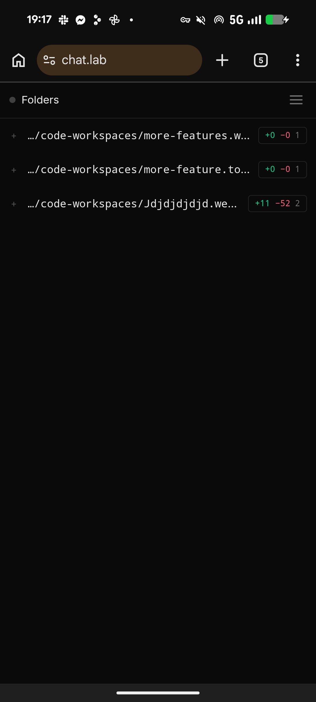
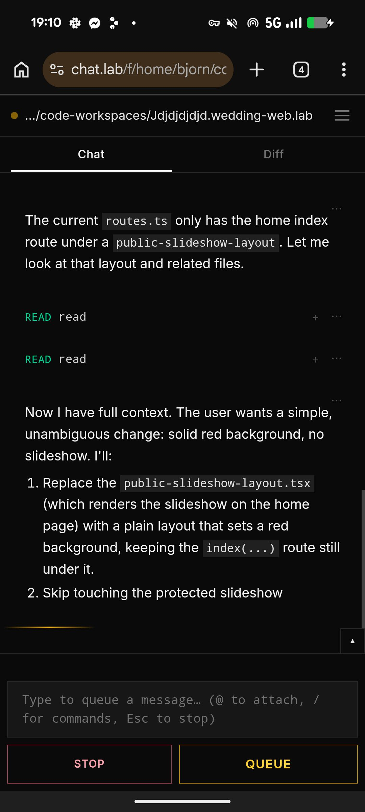
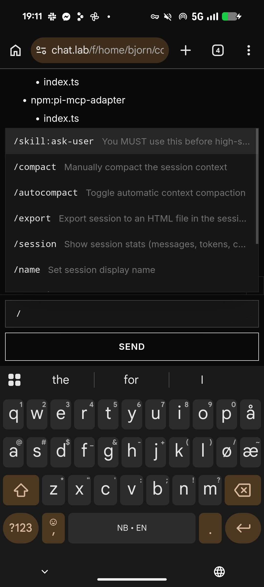
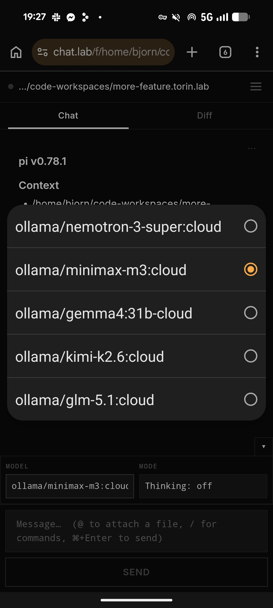
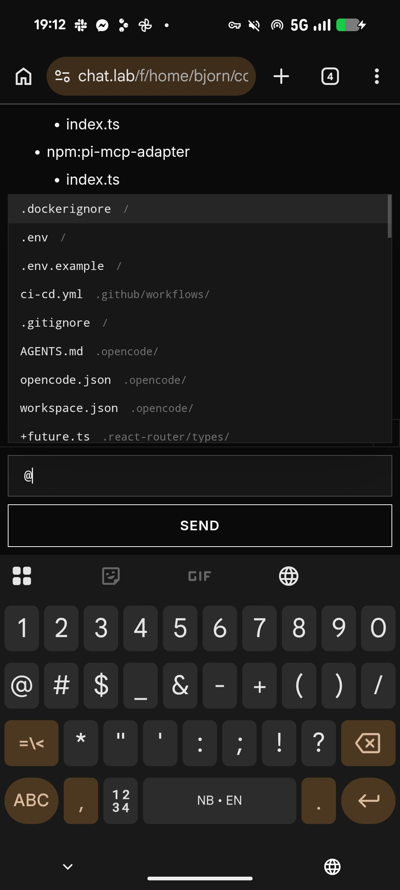
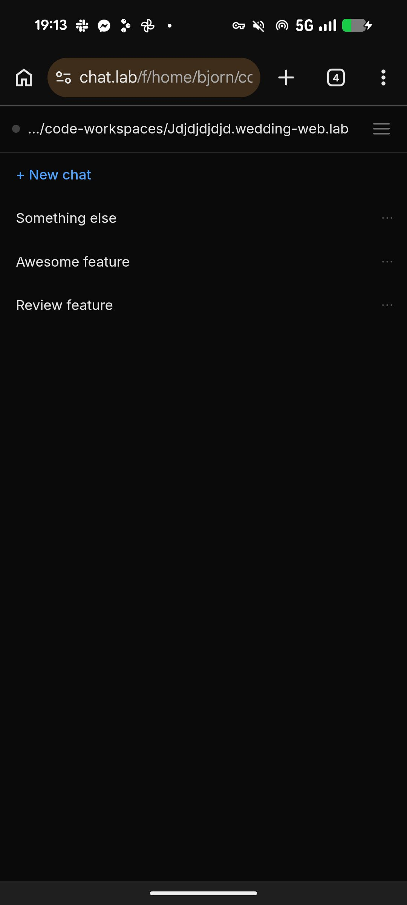
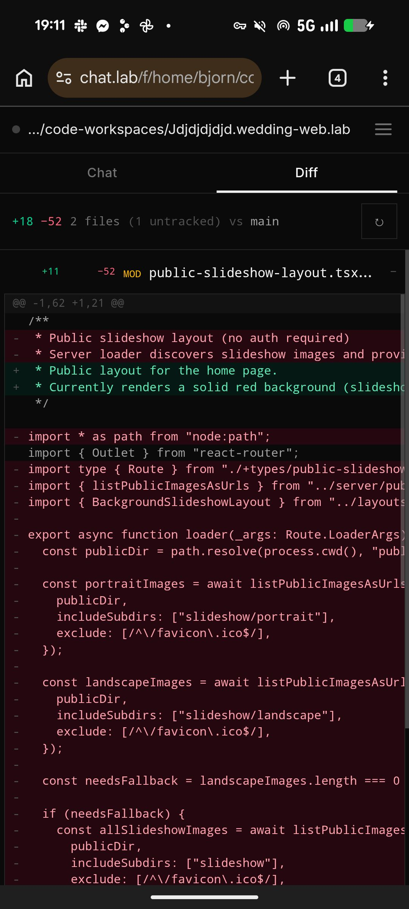

# Voir

A chat interface for [ACP](https://agentclientprotocol.com)-compatible
coding agents. One screen, one conversation per session, mobile-first.

Voir does one thing: it talks JSON-RPC 2.0 to ACP agents and renders
the chat. It does not spawn agents, it does not run agents, and it
does not kill agents. That's the launcher's job.

## Run it

### 1. Start the server

```sh
git clone <this-repo> voir
cd voir
npm install
npm run dev          # http://localhost:9000
```

Open `http://localhost:9000` in your browser. You'll see an empty
**Folders** list — no worktrees are attached yet, that's expected.

With Tailscale up, the dev server also listens on your tailnet
address, so you can preview from your phone at
`http://<tailscale-ip>:9000` (see `vite.config.ts`). Attach agents
exactly as below — the launcher runs on the same machine, so its
`--ui` URL stays loopback regardless of where *you* browse from.

For the features that need a **secure context** on the phone —
microphone (dictation) and the service worker (PWA install) —
plain HTTP over the tailnet doesn't qualify. Use Tailscale's
built-in HTTPS instead (requires *HTTPS Certificates* enabled in
the admin console, DNS section):

```sh
tailscale serve --bg --https=8443 9000
# → https://<machine>.<tailnet>.ts.net:8443
```

Same origin as far as the browser is concerned, real Let's
Encrypt cert, still tailnet-only, and `vite.config.ts` already
allows the `<tailnet>.ts.net` Host header. 443 is the default
HTTPS port for serve — pass `--https=8443` (any of 443/8443/10000)
when 443 is already taken, e.g. by a reverse proxy fronting your
production instances. The phone URL for everything voice/PWA is
then `https://<machine>.<tailnet>.ts.net:8443`.



For a production-style run:

```sh
npm run build
npm start            # http://localhost:9000
```

### 2. Pick an ACP agent and add a chat

You need an ACP-compatible agent on your `PATH`. Pick one:

- `opencode acp` — OpenCode
- `pi-acp` — Pi
- `claude-agent-acp` — Claude (via `@agentclientprotocol/claude-agent-acp`)
- `codex-acp` — Codex (via `@zed-industries/codex-acp`)
- `copilot-acp` — GitHub Copilot
- anything else in the [ACP registry](https://agentclientprotocol.com/get-started/agents)

Then `cd` into a worktree and start the launcher:

```sh
cd ~/worktrees/feat-42
node /path/to/voir/bin/acp-spawn.mjs \
  --agent opencode acp \
  --name opencode \
  --ui http://localhost:9000
```

The launcher spawns the agent, picks a free port, starts a stdio→HTTP
bridge, and registers the folder with Voir. You'll see something like:

```
opencode acp bridge for /home/you/worktrees/feat-42 on http://127.0.0.1:43127/
registered → browse: http://localhost:9000/f/home/you/worktrees/feat-42
```

Open that URL (or just refresh `http://localhost:9000`) and the folder
shows up. **+ New chat**, type, send. The agent streams its reply.



A few things the chat can do, when the agent supports them:

- **Slash commands** — type `/` in the composer; if the agent
  advertises commands (e.g. `/compact`, `/init`), they appear in a
  popover.

  
- **Switch model mid-session** — the chevron above the composer
  opens a drawer listing the models the agent has advertised. Pick
  one and the next turn uses it. A third select in the same drawer
  **switches the fence** for supervisor-managed agents (see
  *Keep a fleet running* below) — pick a preset and the supervisor
  restarts the agent under its new command, session intact.

  

- **@-file mentions** — type `@` to attach a file from the
  worktree to your next message.

  

- **Image attach** — the paperclip (camera or gallery on the
  phone, paste/drop on the desktop) attaches images when the
  agent advertises `promptCapabilities.image`; the browser
  shrinks phone photos before upload and the prompt carries
  ACP image content blocks. Thumbnails live in voir's upload
  store and re-attach from `[Image: <id>]` wire markers on
  replay — they survive voir restarts and agent resyncs. The
  model drawer marks vision-capable models (`· vision`) and
  warns when attaching under a text-only model.
  Design: [docs/images-and-share.md](./docs/images-and-share.md).

Want it on `PATH`?

```sh
# Either symlink it:
ln -s /path/to/voir/bin/acp-spawn.mjs ~/.local/bin/acp-spawn

# Or install Voir globally:
npm install -g /path/to/voir
acp-spawn --agent opencode acp --name opencode --ui http://localhost:9000
```

### 3. Multiple sessions in one worktree

A folder can hold as many sessions as you want. Open the folder in
Voir, hit **+ New chat** as many times as you like — each one is its
own conversation thread with the same agent, sharing the same
worktree. Switch between them from the folder view.



If you want to compare two agents in the same worktree, run two
launchers with different `--name`s and different `--port`s — each
one becomes its own folder, with its own sessions.

Each session can also open its worktree's **Diff** tab to see exactly
what the agent changed since the worktree branched — every file,
every hunk, plus uncommitted edits.



### 4. Add more chats

Every worktree is its own chat. Just `cd` somewhere else and start
another launcher. The folder list grows; the sessions don't share
state. `--name` is optional — omitted, a random `agent-<hex6>`
identity is generated, so several agents can even share one
worktree without colliding.

```sh
cd ~/worktrees/other-thing
acp-spawn --agent codex-acp --name codex --ui http://localhost:9000
```

### 5. Tear down

`Ctrl-C` the launcher. The folder disappears from Voir, the agent
subprocess is killed, the bridge port is freed. If you `kill -9` the
launcher, Voir's heartbeat notices the endpoint is gone within
~10 seconds and marks the folder `degraded` (offline badge, kept
sessions) — it keeps probing and heals automatically if the agent
comes back; a human can remove the folder explicitly when wanted.

## Connection resilience

There are two legs to keep alive, and both self-heal:

**Browser → Voir.** The chat view holds one SSE connection per
session, and it is designed to survive everything a phone can
throw at it:

- **Dropped connections reconnect automatically** — exponential
  backoff from 1s to a 15s cap, forever. Reconnecting replays
  the transcript from the server, so nothing is lost.
- **Backgrounding the app** (iOS/Android killing the socket
  while the tab is hidden) is detected on the next
  `visibilitychange` and reconnects immediately.
- **Half-open sockets** (mobile NAT reaping the TCP connection
  without telling the browser) are caught by a watchdog: if
  nothing — not even a keep-alive ping — arrives for 45s, the
  connection is rebuilt.
- **Voir restarting** doesn't orphan anything. The launcher
  re-registers its folder every 30s, an open stream rehydrates
  an unknown session from the agent, and the chat shows a small
  banner ("Agent offline — retrying…") until it's back — no
  page refresh needed, ever.

**Voir → agent.** The server-side leg heals itself too:

- **The agent's SSE notification stream reconnects on its own**
  with backoff (1s → 30s cap) after a drop, and fires a
  reconnect event in the session manager.
- **Reconnect = resync.** Every session/update pushed while the
  leg was down was lost, so after each recovery Voir replays
  the folder's sessions from agent truth (`session/list` +
  `session/load`). Live tabs are asked to re-snapshot via a
  `resync` control message and rebuild their transcript — no
  silent divergence, ever.
- **Heartbeat failure degrades, never deletes.** A failing ping
  marks the folder offline (badge in the sidebar, sessions kept)
  and keeps probing; recovery triggers the same resync. The
  old three-strike unregister — which destroyed recoverable
  state on a 30-second blip — is gone. Only an explicit
  unregistration removes a folder.
- **Health checks don't spam the agent.** The bridge answers
  Voir's heartbeat `ping` itself (204 alive / 503 child dead);
  it is not an ACP method and is never forwarded to the agent.

## Sandbox the agent

The launcher takes any command, so wrap the agent in whatever
sandbox you trust before `--agent`:

```sh
acp-spawn --agent 'fence exec --private . -- opencode acp'    --name opencode --ui http://localhost:9000
acp-spawn --agent 'bwrap --unshare-all --bind . . --tmpfs /tmp --dev --proc -- opencode acp' \
          --name opencode --ui http://localhost:9000
acp-spawn --agent 'firejail --noprofile --private=. -- opencode acp' --name opencode --ui http://localhost:9000
```

Voir does not sandbox. That is the launcher's job, and the launcher's
job is yours.

## Keep a fleet running (supervisor)

One-shot launchers die with their terminal — right for scratch
worktrees and comparisons. For folders that should always be
running, `voir-supervisor` owns a desired-state file
(`~/.local/state/voir/agents.json`), starts and restarts agents
per its preset catalog
(`~/.config/voir/supervisor.json` — where your fence commands
live), and re-registers with Voir every 30s so restarts on either
side self-heal:

```sh
voir-supervisor add ~/code/infra --preset pi-fenced
voir-supervisor            # run the daemon (systemd unit in the docs)
voir-supervisor ls
```

The fence itself switches live from the chat: the model/mode
drawer's **Fence** select lists the catalog's presets — pick one
and the supervisor restarts the agent under the new command
(without unregistering, so the open session survives), Voir
clears its switched caches on the next registration and
re-syncs from agent truth. A **Clear cache** row at the drawer's
bottom does the same on demand, and the folder list shows which
fence each worktree runs (row chip). The CLI equivalent is
`voir-supervisor set <name|dir> --preset <p>`.

Full configuration and behavior reference:
[docs/supervisor.md](./docs/supervisor.md).

## Install it on your phone (PWA)

Voir is an installable progressive web app: manifest, service
worker (network-first navigations with an offline fallback
page) and a generated icon set (`bin/gen-icons.py`).

- **Android/Chrome:** open the site → menu → *Install app* / *Add
  to Home screen*. You get a standalone window, its own icon and an
  offline page when the server is unreachable. As an installed PWA
  it also registers as a **share target**: share a screenshot or
  text from any app → Voir stages it and offers the pick of your
  chats ("Send to…" sheet — Working-on rows, recent sessions, or a
  fresh chat) — the composer seeds with what you shared. Requires
  the same secure-context HTTPS as the other PWA extras.
- **iOS/Safari:** Share → *Add to Home Screen*. The app runs
  standalone with a translucent status bar. (iOS doesn't implement
  share targets — the paperclip covers iOS.)

The service worker deliberately does no app-shell caching — the
transcript always comes live from the server and the page's own
reconnect logic (above) handles transport hiccups. Web Push handlers
live in `public/sw.js` — `push`, `notificationclick` (with an
inline-reply action on supporting browsers) and
`pushsubscriptionchange`. The share-target handler lives there too
(`POST /share` → staged server-side → redirect to the Send-to sheet —
see [docs/images-and-share.md](./docs/images-and-share.md)).
Machine-initiated conversations arrive via
`POST /api/inbox` — the design and its production use are in
[docs/two-way.md](./docs/two-way.md).

## Voice

Three voice affordances, in increasing ambition:

- **Dictation (speech → text):** **press and hold the Send
  button** (hold ≥ ~250ms; works with the Queue button during a
  turn too). A live-transcription popup opens over the composer
  while you talk — the on-screen keyboard stays out of the way
  until you tap the field yourself. After a brief "Transcribing…"
  flush the transcript lands in the composer as a reviewable
  draft — never auto-sent, since recognition makes mistakes and an
  agent turn is expensive. A short press still sends immediately.
  Uses the browser's built-in Web Speech API (Chrome, Edge,
  Safari/iOS 14.5+; on Firefox the hold does nothing and the
  button stays press-to-send) **and a secure context** — over the
  tailnet that means the `tailscale serve` HTTPS URL, not plain
  HTTP. Long silences don't end the session while you keep holding
  — restarts retry through transient dropouts; only a mic that
  stays dead through the retry budget ends early ("Mic ended —
  release"). Release (or an incoming call) commits what was said
  so far.
- **Spoken replies (text → speech):** the **"Read aloud"** button
  in the chat header narrates agent text messages as they stream,
  sentence by sentence, so the voice tracks the text instead of
  waiting for the turn to end. The choice persists in
  localStorage; sending a new message cancels any still-queued
  audio so turns can't talk over each other.
- **Voice conversation mode:** the **"Voice"** button in the
  chat header — hands-free, ChatGPT-style. The mic streams raw
  audio to the server (`/api/voice`), which relays it to a
  streaming STT provider (API key in env, never in the browser)
  and streams the transcript back. Pause when you're done and it
  auto-sends after a short review window — tap the mic orb to
  edit the transcript instead (fixing STT mistakes), or just keep
  talking to continue the utterance. The reply is narrated
  automatically (voice mode forces narration on), and when the
  voice goes quiet the mic re-opens for the next turn — tap the
  orb during thinking/speaking to interrupt. There are no browser
  recognizer sessions in this pipeline, so nothing can
  "MIC ENDED" mid-hold; a dropped connection reconnects with
  backoff and the draft survives. Requires the same secure
  context. Dev-server-only for now (`react-router-serve` has no
  WebSocket story).

  Providers (`VOICE_STT_PROVIDER`): `mock` (default — no key,
  energy-based segmentation emits canned phrases so the whole
  loop can be demoed; used by the docker compose dev stack) or
  `deepgram` (real streaming transcription, needs
  `VOICE_STT_API_KEY`; their VAD drives turn-taking).

  **Narration** is neural by default when a Deepgram key exists:
  sentences stream to `/api/tts`, are synthesized by Aura-2
  (`VOICE_TTS_MODEL`, default `aura-2-thalia-en`), and the
  PCM audio schedules gaplessly on a Web Audio graph. The
  "Read aloud" header toggle uses the same engine. Without a
  key it falls back to the browser's built-in speechSynthesis
  (the noticeably synthetic voices) — set
  `VOICE_TTS_PROVIDER=browser` to force that even with a key.

  The panel's **settings drawer** (the gear next to Done) holds
  all voice settings: the narration **voice picker** with a
  preview button, narration **speed**, **narrate replies
  on/off** (silent voice mode), the **auto-send** review window
  (1s / 2.5s / 5s / manual — manual shows Send/Edit buttons
  instead of a countdown), **auto-listen** (mic re-opens after
  each reply, or pauses for tap-to-talk), **interrupt mode**
  (tap the orb, or keep the mic live through narration so you can
  just speak — headphones), **earcons** (subtle tones when the
  mic opens / a message sends), and **keep screen awake** (Wake
  Lock — the phone screen stays on for the conversation). The
  **Pause** button mutes the mic without leaving voice mode.
  All persisted in localStorage.

## Security: this is your job

Voir is **not secured**. Out of the box it:

- has **no authentication** on any endpoint,
- binds the dev server to **loopback + your Tailscale interface**
  (see `vite.config.ts` — `npm run dev` is reachable from the same
  machine and from your tailnet, e.g. your phone; nothing is bound
  on LAN/WAN interfaces. The docker compose dev setup overrides
  this with `--host 0.0.0.0`, which is fine inside a container),
- will **fetch any `agentUrl`** it's told to via `POST /api/folders`,
  which means an attacker who can reach the server can make it talk
  to internal services on your network.

If you intend to expose Voir beyond `127.0.0.1`, you must put
something in front of it: a reverse proxy (Caddy, nginx, Traefik) with
auth (OIDC, basic auth, mTLS, a Cloudflare Tunnel — whatever fits).
Don't publish this to the internet as-is.

## Observability (estate App APM)

Voir follows the estate observability pattern
(`~/code/infra/observability/faro-recipe.md`): frontend telemetry via the
Grafana Faro Web SDK (`app/faro.ts`, initialized first in
`app/entry.client.tsx`), one server span + an `http_request` JSON log line
per request via `app/lib/otel.server.ts` and
`app/lib/request-log.server.ts` (registered first in `bin/server.ts`).
The faro SDK propagates `traceparent` on every same-origin fetch, so
backend spans join the browser's trace — one Tempo trace per request,
and every error line in Loki links into it. The one join name everywhere
is **`voir`** (faro `app_name` = `OTEL_SERVICE_NAME` = the k8s pod label).

Enablement is env-driven, never hardcoded:

- Frontend: `VITE_FARO_*` vars (`.env` here, Docker build args for image
  builds — see the Dockerfile), baked at `npm run build` time.
- Backend: `OTEL_SERVICE_NAME=voir` + `OTEL_EXPORTER_OTLP_ENDPOINT`
  (in-cluster `http://tempo.monitoring.svc.cluster.local:4318`; devbox gets
  the tailnet NodePort `http://100.66.57.52:30093`). Unset endpoint →
  tracing off, zero overhead.
- Dashboard: **App APM** (`app-apm`) on
  https://grafana.stackunderflow.no — voir appears in its `$app` picker
  as soon as an instrumented browser ships an event. `/healthz` is served
  but never logged or traced (k8s probes are noise).
- Dev note: `npm run dev` (vite) has no span middleware — frontend telemetry
  only; the express server shape (`bin/server.ts`, used by the devbox
  systemd unit and the Docker image) is where backend tracing lives.

## What it is and isn't

**It is:**
- A chat. One screen, one conversation, mobile-first.
- A worktree-diff view, because the most useful thing to look at after
  an agent edits your code is what it changed.
- An ACP client. It speaks JSON-RPC 2.0 to anything on the other end
  of `--agent`.

**It isn't:**
- A worktree manager. It does not know how to create worktrees.
- An agent runner. `acp-spawn` runs the agent; Voir just talks to it.
- A sandbox. Sandboxing is whatever you put in front of `--agent`.
- A finished product. The mobile-friendly chat shell is the smallest
  unit that's actually usable on a phone; everything else — multiple
  parallel agents, complex tool approval flows, etc. — is something
  you build on top of this.

This is the smallest unit that does mobile development. You write the
tooling to set up ACP servers, connect them, and orchestrate them.
Voir is the chat.

## Commands

| Command | What it does |
| --- | --- |
| `npm run dev` | Vite dev server with HMR on port 9000 |
| `npm run build` | Production build of the SSR bundle |
| `npm start` | Serve the built bundle (defaults to port 9000) |
| `npm test` | Run unit tests (Node's built-in test runner) |
| `npm run typecheck` | Generate route types and run `tsc` |

## Automatic dependency updates

[Dependabot](.github/dependabot.yml) checks npm packages, the Node Docker images
and the GitHub Actions versions weekly, and opens one PR per update. Every PR
runs [CI](.github/workflows/ci.yml) (typecheck → build → tests); when that's
green the PR is squash-merged automatically. If a merge hits a lockfile
conflict, CI asks Dependabot to rebase and retries — nothing to babysit.

## License

MIT.
