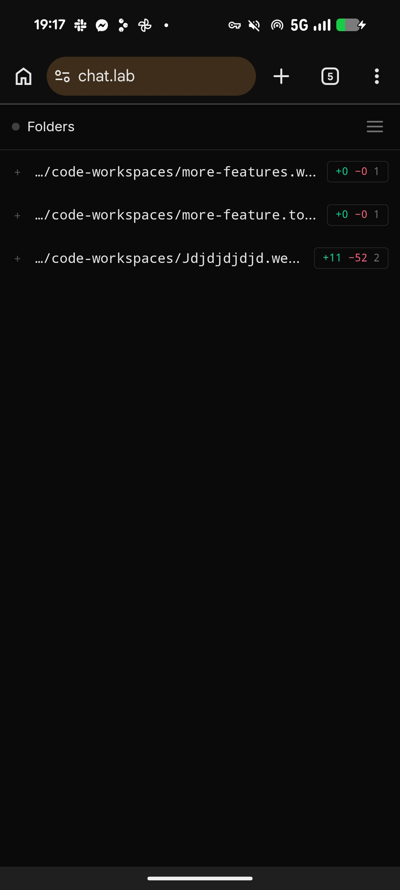
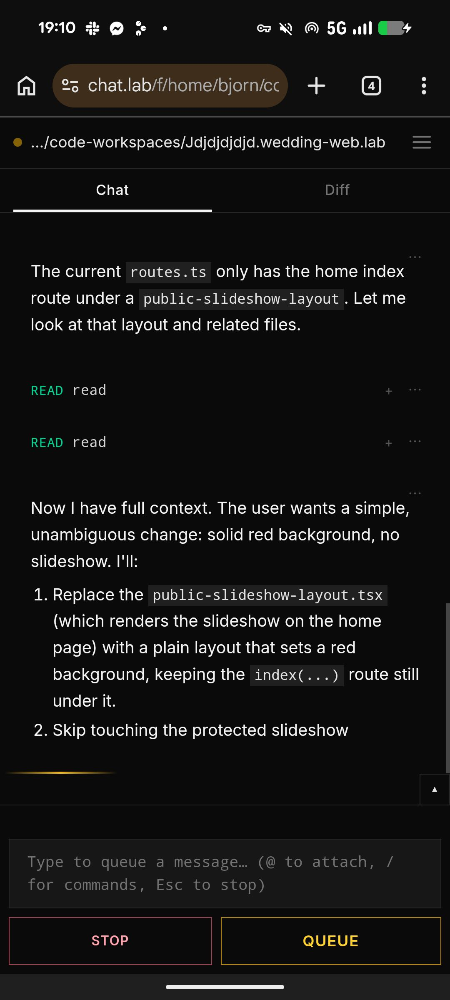
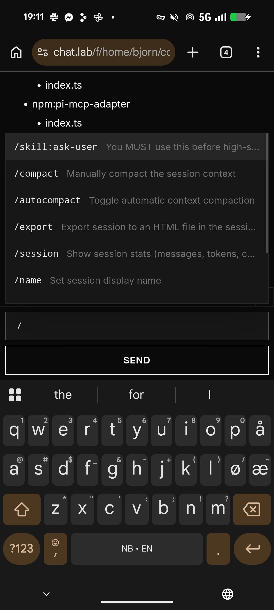
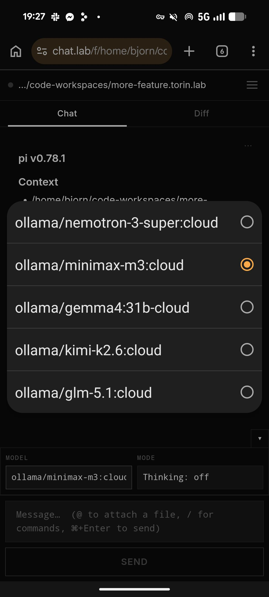
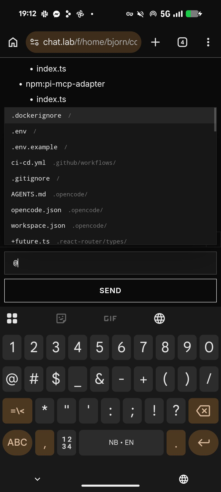
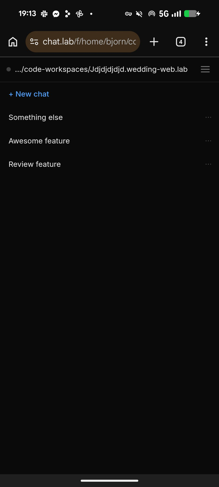
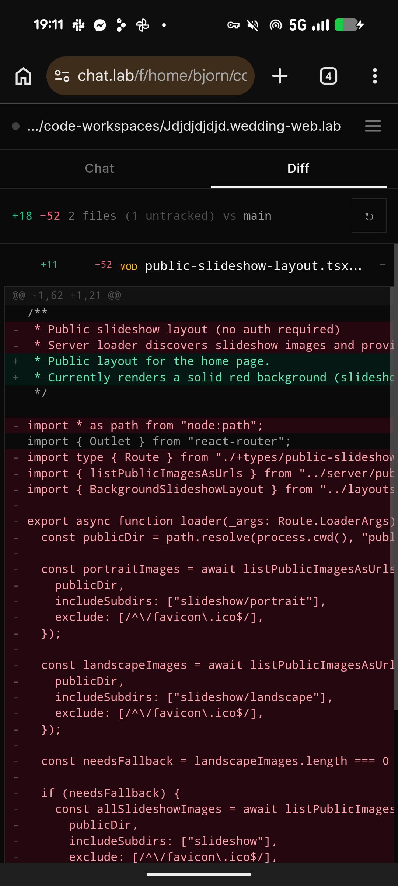

# Voir

A chat interface for [ACP](https://agentclientprotocol.com)-compatible
coding agents. One screen, one conversation per session, mobile-first.

Voir does one thing: it talks JSON-RPC 2.0 to ACP agents and renders
the chat. It does not spawn agents, it does not run agents, and it
does not kill agents. That's the launcher's job.

## Run it

### 1. Start the server

```sh
git clone <this-repo> voir
cd voir
npm install
npm run dev          # http://localhost:9000
```

Open `http://localhost:9000` in your browser. You'll see an empty
**Folders** list — no worktrees are attached yet, that's expected.

With Tailscale up, the dev server also listens on your tailnet
address, so you can preview from your phone at
`http://<tailscale-ip>:9000` (see `vite.config.ts`). Attach agents
exactly as below — the launcher runs on the same machine, so its
`--ui` URL stays loopback regardless of where *you* browse from.

For the features that need a **secure context** on the phone —
microphone (dictation) and the service worker (PWA install) —
plain HTTP over the tailnet doesn't qualify. Use Tailscale's
built-in HTTPS instead (requires *HTTPS Certificates* enabled in
the admin console, DNS section):

```sh
tailscale serve --bg --https=8443 9000
# → https://<machine>.<tailnet>.ts.net:8443
```

Same origin as far as the browser is concerned, real Let's
Encrypt cert, still tailnet-only, and `vite.config.ts` already
allows the `<tailnet>.ts.net` Host header. 443 is the default
HTTPS port for serve — pass `--https=8443` (any of 443/8443/10000)
when 443 is already taken, e.g. by a reverse proxy fronting your
production instances. The phone URL for everything voice/PWA is
then `https://<machine>.<tailnet>.ts.net:8443`.



For a production-style run:

```sh
npm run build
npm start            # http://localhost:9000
```

### 2. Pick an ACP agent and add a chat

You need an ACP-compatible agent on your `PATH`. Pick one:

- `opencode acp` — OpenCode
- `pi-acp` — Pi
- `claude-agent-acp` — Claude (via `@agentclientprotocol/claude-agent-acp`)
- `codex-acp` — Codex (via `@zed-industries/codex-acp`)
- `copilot-acp` — GitHub Copilot
- anything else in the [ACP registry](https://agentclientprotocol.com/get-started/agents)

Then `cd` into a worktree and start the launcher:

```sh
cd ~/worktrees/feat-42
node /path/to/voir/bin/acp-spawn.mjs \
  --agent opencode acp \
  --name opencode \
  --ui http://localhost:9000
```

The launcher spawns the agent, picks a free port, starts a stdio→HTTP
bridge, and registers the folder with Voir. You'll see something like:

```
opencode acp bridge for /home/you/worktrees/feat-42 on http://127.0.0.1:43127/
registered → browse: http://localhost:9000/f/home/you/worktrees/feat-42
```

Open that URL (or just refresh `http://localhost:9000`) and the folder
shows up. **+ New chat**, type, send. The agent streams its reply.



A few things the chat can do, when the agent supports them:

- **Slash commands** — type `/` in the composer; if the agent
  advertises commands (e.g. `/compact`, `/init`), they appear in a
  popover.

  

- **Switch model mid-session** — the chevron above the composer
  opens a drawer listing the models the agent has advertised. Pick
  one and the next turn uses it.

  

- **@-file mentions** — type `@` to attach a file from the
  worktree to your next message.

  

Want it on `PATH`?

```sh
# Either symlink it:
ln -s /path/to/voir/bin/acp-spawn.mjs ~/.local/bin/acp-spawn

# Or install Voir globally:
npm install -g /path/to/voir
acp-spawn --agent opencode acp --name opencode --ui http://localhost:9000
```

### 3. Multiple sessions in one worktree

A folder can hold as many sessions as you want. Open the folder in
Voir, hit **+ New chat** as many times as you like — each one is its
own conversation thread with the same agent, sharing the same
worktree. Switch between them from the folder view.



If you want to compare two agents in the same worktree, run two
launchers with different `--name`s and different `--port`s — each
one becomes its own folder, with its own sessions.

Each session can also open its worktree's **Diff** tab to see exactly
what the agent changed since the worktree branched — every file,
every hunk, plus uncommitted edits.



### 4. Add more chats

Every worktree is its own chat. Just `cd` somewhere else and start
another launcher with a different `--name`. The folder list grows; the
sessions don't share state.

```sh
cd ~/worktrees/other-thing
acp-spawn --agent codex-acp --name codex --ui http://localhost:9000
```

### 5. Tear down

`Ctrl-C` the launcher. The folder disappears from Voir, the agent
subprocess is killed, the bridge port is freed. If you `kill -9` the
launcher, Voir's heartbeat will notice the endpoint is gone and drop
the folder within ~30 seconds (the heartbeat tolerates a couple
of transient failures before dropping a folder).

## Connection resilience

The chat view holds one SSE connection per session, and it is
designed to survive everything a phone can throw at it:

- **Dropped connections reconnect automatically** — exponential
  backoff from 1s to a 15s cap, forever. Reconnecting replays
  the transcript from the server, so nothing is lost.
- **Backgrounding the app** (iOS/Android killing the socket
  while the tab is hidden) is detected on the next
  `visibilitychange` and reconnects immediately.
- **Half-open sockets** (mobile NAT reaping the TCP connection
  without telling the browser) are caught by a watchdog: if
  nothing — not even a keep-alive ping — arrives for 45s, the
  connection is rebuilt.
- **Voir restarting** doesn't orphan anything. The launcher
  re-registers its folder every 30s, an open stream rehydrates
  an unknown session from the agent, and the chat shows a small
  banner ("Agent offline — retrying…") until it's back — no
  page refresh needed, ever.

## Sandbox the agent

The launcher takes any command, so wrap the agent in whatever
sandbox you trust before `--agent`:

```sh
acp-spawn --agent 'fence exec --private . -- opencode acp'    --name opencode --ui http://localhost:9000
acp-spawn --agent 'bwrap --unshare-all --bind . . --tmpfs /tmp --dev --proc -- opencode acp' \
          --name opencode --ui http://localhost:9000
acp-spawn --agent 'firejail --noprofile --private=. -- opencode acp' --name opencode --ui http://localhost:9000
```

Voir does not sandbox. That is the launcher's job, and the launcher's
job is yours.

## Install it on your phone (PWA)

Voir is an installable progressive web app: manifest, service
worker (network-first navigations with an offline fallback
page) and a generated icon set (`bin/gen-icons.py`).

- **Android/Chrome:** open the site → menu → *Install app* / *Add
  to Home screen*. You get a standalone window, its own icon and an
  offline page when the server is unreachable.
- **iOS/Safari:** Share → *Add to Home Screen*. The app runs
  standalone with a translucent status bar.

The service worker deliberately does no app-shell caching — the
transcript always comes live from the server and the page's own
reconnect logic (above) handles transport hiccups. When
AI-initiated chats + Web Push notifications arrive, the `push`
and `notificationclick` handlers land in `public/sw.js`.

## Voice

Two affordances, both using the browser's built-in speech APIs —
no extra services, no API keys, nothing leaves the device's
platform speech stack:

- **Dictation (speech → text):** **press and hold the Send
  button** (hold ≥ ~250ms; works with the Queue button during a
  turn too). A live-transcription popup opens over the composer
  while you talk; release and the transcript lands in the
  composer as a reviewable draft — never auto-sent, since
  recognition makes mistakes and an agent turn is expensive. A
  short press still sends immediately. Requires a browser with
  the Web Speech API (Chrome, Edge, Safari/iOS 14.5+; on Firefox
  the hold does nothing and the button stays press-to-send) **and
  a secure context** — over the tailnet that means the
  `tailscale serve` HTTPS URL, not plain HTTP (see above).
  Long silences don't end the session while you keep holding;
  release (or an incoming call) commits what was said so far.
- **Spoken replies (text → speech):** the **"Read aloud"** button
  in the chat header — that's the speaker icon's label and its
  whole job: when on, agent text messages are narrated as they
  stream, sentence by sentence, so the voice tracks the text
  instead of waiting for the turn to end. The choice persists in
  localStorage; sending a new message cancels any still-queued
  audio so turns can't talk over each other.

## Security: this is your job

Voir is **not secured**. Out of the box it:

- has **no authentication** on any endpoint,
- binds the dev server to **loopback + your Tailscale interface**
  (see `vite.config.ts` — `npm run dev` is reachable from the same
  machine and from your tailnet, e.g. your phone; nothing is bound
  on LAN/WAN interfaces. The docker compose dev setup overrides
  this with `--host 0.0.0.0`, which is fine inside a container),
- will **fetch any `agentUrl`** it's told to via `POST /api/folders`,
  which means an attacker who can reach the server can make it talk
  to internal services on your network.

If you intend to expose Voir beyond `127.0.0.1`, you must put
something in front of it: a reverse proxy (Caddy, nginx, Traefik) with
auth (OIDC, basic auth, mTLS, a Cloudflare Tunnel — whatever fits).
Don't publish this to the internet as-is.

## What it is and isn't

**It is:**
- A chat. One screen, one conversation, mobile-first.
- A worktree-diff view, because the most useful thing to look at after
  an agent edits your code is what it changed.
- An ACP client. It speaks JSON-RPC 2.0 to anything on the other end
  of `--agent`.

**It isn't:**
- A worktree manager. It does not know how to create worktrees.
- An agent runner. `acp-spawn` runs the agent; Voir just talks to it.
- A sandbox. Sandboxing is whatever you put in front of `--agent`.
- A finished product. The mobile-friendly chat shell is the smallest
  unit that's actually usable on a phone; everything else — multiple
  parallel agents, complex tool approval flows, etc. — is something
  you build on top of this.

This is the smallest unit that does mobile development. You write the
tooling to set up ACP servers, connect them, and orchestrate them.
Voir is the chat.

## Commands

| Command | What it does |
| --- | --- |
| `npm run dev` | Vite dev server with HMR on port 9000 |
| `npm run build` | Production build of the SSR bundle |
| `npm start` | Serve the built bundle (defaults to port 9000) |
| `npm test` | Run unit tests (Node's built-in test runner) |
| `npm run typecheck` | Generate route types and run `tsc` |

## License

MIT.
