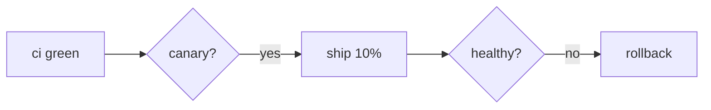

# Voir rich content — block schemas and examples

This session is (or may be) attached to **voir**, a chat host for ACP
agents. Voir intercepts specific fenced code blocks in your replies and
renders them as rich, interactive cards instead of code. All carriers are
plain markdown — an agent that never reads this file still degrades to a
readable transcript.

Detection runs on **settled** turns only: emit each fence complete within
the turn's final text (streaming partials show as code until the turn ends).

## `voir-card` — summary cards (verdicts, metrics, briefings, alerts)

````
```voir-card
{ "title": "hiet checkup 2026-11-04",
  "pill": { "text": "healthy", "tone": "good" },
  "rows": [
    { "k": "disk /", "v": "42%", "delta": "-2%", "spark": [30, 33, 41, 44, 43, 42] },
    { "k": "memory pressure", "v": "12%", "spark": [14, 12, 13, 12, 12, 12] },
    { "k": "failing pods", "v": "0" }
  ],
  "actions": [
    { "label": "Drill into disk", "kind": "prefill", "value": "Why did disk usage grow this week?" },
    { "label": "Ack", "kind": "send", "value": "Checkup acknowledged." },
    { "label": "Open alerts", "kind": "link", "value": "https://grafana.example.com/alerting" }
  ] }
```
````

- `pill.tone`: `good` (emerald) | `warn` (amber) | `bad` (rose) | `info`.
- `spark`: ≥2 numbers, or `[epochMs, value]` pairs — drawn as a sparkline.
- **Actions are the interaction surface:**
  - `kind: "send"` — tapping sends `value` as a **user message** to you
    immediately (you then act on it with your tools). Use for acks,
    confirmations, "handle it" continuations.
  - `kind: "prefill"` — `value` lands in the composer as an **editable
    draft**. Use for drill-into / follow-up questions.
  - `kind: "link"` — opens the URL in a new tab.
- The **label must tell the truth** about what tapping does. Compose
  `value` for send/prefill as a self-contained instruction (you get it as
  a user turn with the card's context already in the transcript).
- Keep cards dense: 3–6 rows, one idea per card.

## `voir-chart` — charts (the agent-agnostic graph)

Query your data with whatever tools you have (Prometheus, files, curl),
then emit the series — the host renders it (uPlot, dark theme, real axes):

````
```voir-chart
{ "title": "CPU & memory (last 6h)", "unit": "pct", "type": "line",
  "series": [
    { "label": "cpu",    "points": [[1730700000000, 42], [1730700900000, 38], [1730701800000, 47]] },
    { "label": "memory", "points": [[1730700000000, 61], [1730700900000, 60], [1730701800000, 63]] }
  ] }
```
````

- `type`: `line` (default) | `area`. x = epoch ms, y = number.
- ≥2 points per series; single-point series are dropped.
- Timestamps need not align across series (gaps render as gaps).
- Do NOT include styling — title/unit/series are the whole contract.

## `mermaid` — standard diagrams

````

````

Prefer mermaid for flowcharts, sequence, state, ER, gantt — it is compact,
reliable, and renders everywhere that knows the convention.

## `d3` — bespoke visualizations (your code, sandboxed)

````d3
```d3
const data = [12, 30, 22, 40, 18];
const svg = d3.select("#viz").append("svg")
  .attr("width", innerWidth).attr("height", innerHeight - 8);
svg.selectAll("rect").data(data).join("rect")
  .attr("x", (_d, i) => i * (innerWidth / data.length) + 4)
  .attr("width", innerWidth / data.length - 8)
  .attr("y", (d) => innerHeight - d * 4)
  .attr("height", (d) => d * 4)
  .attr("fill", (d) => (d > 35 ? "#f87171" : "#fbbf24"));
```
````

- Runs in an **opaque-origin sandbox**: no network to voir, no cookies,
  no tokens — embed all data inline. Scripts allowed; CDN (`cdn.jsdelivr.net`,
  `esm.sh`) reachable for extra libraries.
- `d3` (v7) is preloaded; `#viz` is the mount div; size to
  `innerWidth`/`innerHeight`. Errors render as red text in the frame.
- Use when no structured block fits (force graphs, treemaps, custom plots).

## `html` — single-file apps

````
```html
<!doctype html>
<html><head><style>…</style></head>
<body>… your app …<script>…</script></body></html>
```
````

Same sandbox as d3 (opaque origin, CSP-allowlisted CDNs). One document =
one app: inline CSS/JS, import maps for React/Solid from the CDN, forms
and layout. The frame has expand/collapse and an open-standalone action.

## Worktree image thumbnails

When you produce image files (matplotlib dashboards, plots, diagrams),
**mention the path in backticks** in your prose — the host renders an
inline thumbnail from the worktree and the user taps through:

> The dashboard is ready — here's what I built:
> ## `covid-dashboard-2020-06-09.png` (2850×3150)

Relative paths below the worktree root; extensions png/jpg/webp/gif/avif/svg.

## Choice guide

| you want to show | use |
| --- | --- |
| verdict / metrics / briefing summary + follow-up buttons | `voir-card` |
| queried time series / numeric series | `voir-chart` |
| flowcharts, sequence, state, ER | `mermaid` |
| bespoke graphic (network, treemap, custom) | `d3` |
| interactive mini-app (calculator, comparison, form-y UI) | `html` |
| an image file you wrote | backticked path in prose |

Don't wrap ordinary prose in cards — cards are for things that read like
summaries. One card per idea.
